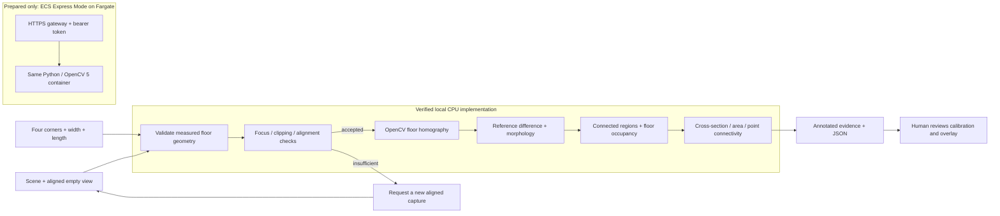

# ClearPath architecture

`clearpath/vision.py` contains the actual image operations and measurements; the same function serves the CLI and Flask API. `fixtures.py` independently generates scene images, truth masks and labels. `evaluate.py` compares output masks and measurements against those labels. The fixture identifier only selects image inputs and calibration; the detector never reads ground-truth masks or expected answers.

The browser uses `GET /api/fixtures`, `GET /health`, and `POST /api/inspect`. JSON requests select a controlled fixture. Multipart requests carry two PNG/JPEG images and a calibration JSON object. Images are limited to 8 MB and 8 megapixels each. Reports include runtime evidence, capture requests, policy trace, quality values, measurements when accepted, PNG evidence, and limitations. No upload persistence is implemented. A downloaded JSON adds the browser's human-review acknowledgment.

The recapture policy is deterministic: observed geometry or quality changes the next action from measurement to a specific capture request. It is not an LLM agent. Optional Agentic Vision eligibility must be confirmed before describing this policy as qualifying for that award.
